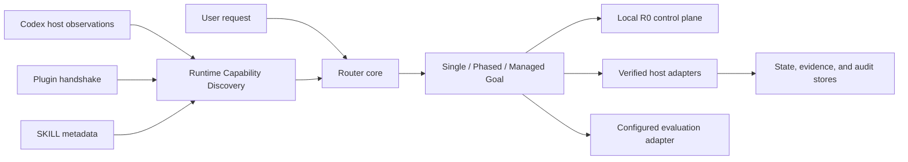

# Workflow Skill Router

**Make your Claude Code and Codex workflow repeatable.**

One lead Skill per phase, only the support that phase needs, and your workflow saved as config you can reuse.

[](https://github.com/eric861129/Workflow-skill-router/actions/workflows/validate.yml)
[](https://github.com/eric861129/Workflow-skill-router/releases)
[](LICENSE)

[繁體中文](README.zh-TW.md) · [Documentation](https://huangchiyu.com/Workflow-skill-router/) · [Install](#install) · [See a route](#see-a-route) · [Evidence and limits](#evidence-and-limits)

[](https://huangchiyu.com/Workflow-skill-router/showcase/)

Workflow Skill Router is an open-source Plugin for Claude Code and Codex. Before your agent starts work, it picks the Skill that should lead the current phase, adds only the support that phase needs, and shows you the plan. You define the workflow once, and the Router applies it to every task.

## What you get

- **A focused route for each phase.** Planning an API change does not pull in implementation or deployment Skills before they are needed.
- **Your choices stay in charge.** When you name a Skill, it leads. Support outside your choice needs your consent first.
- **Your workflow as config.** A personal or workspace Skill Tree maps tasks to Skills and completion checks. The same Profile works in Claude Code and Codex.
- **A clear record of what ran.** A Skill in the plan is not treated as a Skill the environment can use. When the work ends, you see planned and actual Skill usage side by side.

## Install

Both Plugins need **Node.js 24+ and Python 3.11+**. They include the compiled MCP bundle and Python runtime, so you do not need npm.

### Claude Code

Claude Code support starts with `v2.1.0`.

```text
/plugin marketplace add eric861129/Workflow-skill-router
/plugin install workflow-skill-router@workflow-skill-router
```

Claude Code reads the workspace Profile from `.claude/workflow-skill-router.json` first and falls back to `.codex/workflow-skill-router.json`. Personal Profiles and local state are shared with the Codex Plugin. See the [Claude Code installation guide](site/src/content/docs/guides/install-claude-code.md).

### Codex Plugin + MCP

Current published V2 release: `2.1.1`. Version 2.1.2, a `plan_work` bug-fix patch, is a prepared candidate that has not been published. Use the pinned release for a normal Codex installation; `v2.1.0` added the Claude Code Plugin and opt-in Workflow Memory; Memory keeps persistent local plans and consent records alongside the routing instructions.

```sh
codex plugin marketplace add eric861129/Workflow-skill-router --ref v2.1.2
codex plugin add workflow-skill-router@workflow-skill-router
codex plugin list
```

Development main may contain later work that is not in `v2.1.2`. The [Plugin installation guide](site/src/content/docs/guides/install-plugin.md) explains how to verify the result.

### Standalone Skill

Choose this mode for routing instructions without the local MCP runtime. Download [the v2.1.2 Skill package](https://github.com/eric861129/Workflow-skill-router/releases/download/v2.1.2/workflow-skill-router-skill-v2.1.2.zip) and extract its inner `workflow-skill-router/` folder into your Codex Skills directory.

The [Skill-only installation guide](site/src/content/docs/guides/install-skill.md) covers the paths and setup. This mode guides model behavior; it cannot persist or enforce the Plugin's consent state machine. No installation includes every specialist Skill your workflow may reference.

### Check that it works

In a new Claude Code session or a new Codex task, ask: **“Show the Workflow Skill Router status and explain which capabilities are available in this environment.”** The answer should report the `bundled-local-r0` runtime and list what is available here.

## See a route

The bundled [workspace Profile example](starter/v2/workflow-skill-router/assets/workspace-routing-profile.example.json) defines an API delivery workflow. With that Profile in place, a request in the `api` domain such as *“Deliver the api contract, implementation, and tests”* produces a phased plan like this:

| Phase | Primary Skill | Support in that phase | Exit gate |
| --- | --- | --- | --- |
| contract | `api-designer` | `api-guidelines-skill` | `contract-reviewed` |
| implementation | `csharp-developer` | none | `implementation-complete` |
| verification | `qa-test-planner` | `playwright` | `tests-passed` |

Only the current phase's Skills become the active route. The next phase is routed again when it starts. Every planned Skill stays `intended-unverified` until the runtime confirms it is installed and available. This shows configurable behavior, not a measured development outcome.

## When it helps

| Your situation | What the Router adds |
| --- | --- |
| You have overlapping Skills and keep explaining which one should lead | A reusable personal or workspace routing profile |
| Your work moves through planning, implementation, and verification | A separate Skill selection and completion check for each phase |
| You need to resume work with dependencies across projects | A local work graph with explicit next steps; native Goal integration requires host support |
| You have one small task and a clear Skill choice | A small route; additional configuration may add little value |

## How it works

1. **Read the task and your explicit choices.** Choose a single task, a phased workflow, or a managed work graph.
2. **Apply your workflow.** Personal Routing Profiles map tasks to a primary Skill and only the support needed in the current phase.
3. **Check what is available.** Runtime Capability Discovery distinguishes an intended selection from a capability the current environment can actually use.
4. **Make the plan inspectable.** Expose the route, missing capabilities, and any required support consent before your agent continues.

The local runtime uses deterministic rules for work classification and profile matching. It does not install or activate Skills, select the underlying model, or grant deployment permission. A Skill is a reusable set of instructions for a particular kind of work. The Router coordinates which Skills to use and when; your agent and the selected Skills still do the work. [Read the architecture](docs/architecture/v2-overview.md).

The project is open source so you can inspect the routing rules, adapt a personal or team workflow, and test whether it helps your own tasks.

## Evidence and limits

The 2026-10-19 exploration compared model-only routing with Router-assisted routing on six cases, using GPT-6.1 Sol, GPT-6 Astra, and GPT-6 Luna at `medium` reasoning. Each case ran once per arm. It tested routing decisions, not completed software development.

The initial run exposed ambiguous case assumptions. After clarifying them and updating the instructions, only Sol was retested in a new paired run: final routing fields matched in 3/6 baseline cases and 6/6 Router cases; the stricter full contract matched in 0/6 and 3/6. The new scores cannot be compared directly with the old contract's scores. Astra and Luna have not been retested with the update. One scoring label still depends on how an indirect Skill request is interpreted; both arms selected the same required capability in that case.

These observations suggest a role in **workflow consistency**, with important limits:

- The models already selected suitable Skills in several simple cases. The Router's added value depends on the workflow rules you need.
- The full instruction package increased input tokens by about 26–28% in this setup. Lower cost, faster delivery, and better code quality have not been demonstrated.
- Single runs do not establish repeatability or formal model qualification. Full Plugin/host integration and real development outcomes were outside this comparison.
- The comparison used only the models listed above. The v2.1.0 release gate is a separate paired run through Claude Code with a Claude model; its maintainer attestation records the model, results, and limits.

Read the [evaluation methodology and detailed findings](evaluation/v2/README.md). The dated findings are currently in Traditional Chinese; the methodology is in English. Findings are exploratory, await review, and do not qualify a release or rank the models.

## Explore further

- [Claude Code installation](site/src/content/docs/guides/install-claude-code.md): install, verify, and share Profiles with Codex.
- [Personal Routing Profiles](site/src/content/docs/concepts/personal-routing-profiles.md): define your workflow and inspect why a rule matched.
- [Runtime capabilities](site/src/content/docs/concepts/runtime-capability-discovery.md): understand the difference between installed, available, and authorized.
- [Security boundaries](site/src/content/docs/reference/security-boundaries.md): learn what remains under user and host control.
- [Contributing](CONTRIBUTING.md): improve the project or report a reproducible routing problem. Include the version, install mode, expected route, and a sanitized result.

<details>
<summary>Technical reference for contributors and integrators</summary>

The sections below describe the development source and its contracts. Release and host-dependent behavior are labeled separately.

The standalone package reports `skill-only-fallback`; it cannot claim the `hybrid-full` conformance label.

## Architecture: Runtime Capability Discovery first

Runtime Capability Discovery separates five facts that agents often collapse: installed metadata, host exposure, authentication, policy eligibility, and freshness. A capability becomes routable only when its risk-specific requirements pass.



Maintainers can start with [the V2 architecture overview](docs/architecture/v2-overview.md).

## Single, Phased, and Managed Goal

- **Single** handles one bounded intent with one minimal primary capability.
- **Phased** preserves distinct stages and reroutes each phase from current evidence.
- **Managed Goal** maintains a resumable work graph, respects dependencies, and treats the Codex Goal as host-owned state.

The Router does not force every task into Goal orchestration. Work shape comes from the request, dependencies, risk, and current Goal relation.

`plan_work` combines **deterministic automatic classification** for the work envelope with an **optional deterministic Profile** for a user-owned Skill Tree. The classifier is a bounded structural and lexical ruleset, not a semantic model; its source, confidence, revision, and reason codes are returned separately from the Profile match source. Planned Skills remain intent only and actual activation stays `unverified`. Explicit Skill Lock and consent boundaries still apply. The local Router does not activate Skills, mutate a native Codex Goal, or grant deployment/production authority.

## Explicit Skill Lock

When the user names a SKILL, that choice becomes authoritative. The Router may recommend support, but it must explain the purpose, scope, refusal consequence, and context cost before activation. Rejected support stays out of active selections.

In Plugin mode, the proposal is persisted before the question is shown. A follow-up model turn classifies only `approved`, `rejected`, or `unclear`; the deterministic MCP transition preserves the bound route and fails closed if Phase, scope, revision, or material context changed. Skill-only mode keeps the same interaction policy as advisory instructions, but cannot claim durable enforcement.

When the user names no SKILL, the Router chooses the smallest sufficient route without repeatedly asking for consent to its own recommendations. Before execution it declares planned SKILL usage; after execution it reports actual usage and any change.

## Personal Routing Profiles

V2 keeps the most valuable part of V1: you can own the Skill Tree. A Personal Routing Profile maps objective keywords, domains, tags, and work modes to a phased route with one Primary, up to three current-phase support SKILLs, and an exit gate per Phase.

> Personal Routing Profiles ship in `v2.0.0-beta.2`. The 36-attempt beta.1 Model Evaluation is historical runtime evidence and does not cover this Profile feature.

Precedence is deterministic: host hard constraints, the user's explicit SKILL for the current request, workspace profile, personal profile, then built-in routing. A workspace profile lives at `.codex/workflow-skill-router.json`; personal profiles live under the external Router data directory. MCP workspace reads are accepted only under a Client-advertised root or `WORKFLOW_SKILL_ROUTER_WORKSPACE_ROOTS`; a model-supplied arbitrary path fails closed. A matched workspace tree replaces the personal tree as one complete route—no implicit deep merge.

```powershell
Copy-Item starter/v2/workflow-skill-router/assets/personal-routing-profile.example.json ./my-profile.json
python plugins/workflow-skill-router/runtime/workflow_skill_router.pyz profile validate .\my-profile.json
python plugins/workflow-skill-router/runtime/workflow_skill_router.pyz profile install .\my-profile.json
python plugins/workflow-skill-router/runtime/workflow_skill_router.pyz profile list
python plugins/workflow-skill-router/runtime/workflow_skill_router.pyz profile preview --objective "Deliver the API" --work-mode phased --domain api
python plugins/workflow-skill-router/runtime/workflow_skill_router.pyz profile preview --objective "Deliver the API" --work-mode phased --domain api --explain
python plugins/workflow-skill-router/runtime/workflow_skill_router.pyz profile lint .\my-profile.json
```

The generated Plugin runtime supports `profile preview --explain` and `profile lint`; both are deterministic diagnostics and expose no SKILL instruction body or authority. Plugin + MCP mode loads and validates profiles deterministically. Skill-only reads the same contract as `skill-only-fallback` only when the Host grants filesystem access to the fixed Profile locations; otherwise the user must provide the Profile content in the conversation. It cannot claim durable loading or enforcement. In both modes, a profile result is `intended-unverified`: Runtime Capability Discovery still decides whether each SKILL is installed, exposed, compatible, authorized, and eligible. A profile never installs a SKILL or grants permission. See [Personal Routing Profiles](site/src/content/docs/concepts/personal-routing-profiles.md).

## MCP tool surface

The `v2.0.2` Plugin exposed these twelve typed tools; `v2.1.0` adds eight Memory tools, for 20 total:

```text
sync_runtime_context       plan_work                  propose_support_consent
transition_support_consent get_next_work              validate_route
record_work_event          evaluate_gate              get_router_status
run_model_evaluation       compare_evaluations        export_router_artifact
```

Tool schemas, risk, required capabilities, and fallback actions are generated from the same contracts used by the server. See the [generated MCP reference](site/src/content/docs/reference/mcp-tools.mdx).

## Runtime readiness matrix

### Previous release (`published-v2.0.2`)

`v2.0.2` has 12 tools: **4 always local-ready + 3 Router-owned conditional-local**, 2 verified-Host-required, and 3 configured-adapter-required. The release includes the local work loop, but not the later Adaptive Workflow Memory implementation.

### v2.1.x and development branch (`development-main`)

`v2.1.0` adds 8 Memory tools, for 20 total; Memory is default-off. This table describes `v2.1.2` and the current checkout.

| Availability | Tools | Conditions |
| --- | --- | --- |
| `local-ready` (10) | `plan_work`, `propose_support_consent`, `transition_support_consent`, `get_router_status`, `get_memory_status`, `remember_workflow`, `record_route_feedback`, `list_workflow_candidates`, `preview_profile_update`, `purge_workflow_memory` | Local tools still enforce input, policy, and confirmation requirements; readiness is not blanket side-effect authorization. |
| `conditional-local` (5) | `get_next_work`, `record_work_event`, `evaluate_gate`, `transition_profile_update`, `rollback_profile_revision` | Requires a Router-owned graph or a policy-bound local Profile operation; local work-loop calls report `authority_mode=router-local`. `get_next_work` reports `host_goal_mutated=false`; event and gate calls report `host_transition_authorized=false`. |
| `verified-host-required` (2) | `sync_runtime_context`, `validate_route` | Verified Host authority remains mandatory. |
| `configured-adapter-required` (3) | `run_model_evaluation`, `compare_evaluations`, `export_router_artifact` | A configured evaluation adapter and authorization remain mandatory. |

Both release and main preserve Explicit Skill Lock and consent. Native Goal remains Host-owned; a local gate pass is not Skill activation, deployment, or production authorization.

| Runtime condition | `get_next_work` | `record_work_event` | `evaluate_gate` |
| --- | --- | --- | --- |
| Valid Router-owned graph | Router-local result | Router-local reported progress | Router-local advisory gate |
| Native Goal | `verified-host-scheduler` | `verified-event-store` + `activation-receipt-verifier` | `verified-evidence-store` + `gate-authority` |
| Missing Router-owned graph | `router-owned-work-graph`; create or replay locally | `router-owned-work-graph`; create or replay locally | `router-owned-work-graph`; create or replay locally |
| Corrupt Router-owned graph | Sanitized `internal-error` | Sanitized `internal-error` | Sanitized `internal-error` |

A missing graph is a local graph-initialization condition, not a reason to invent a Host fallback. A corrupt graph crosses an integrity boundary and returns only a public-safe correlation through `internal-error`; internal corruption details remain in diagnostics. Native Goal work uses the tool-specific verified Host capability shown above. Every unavailable or unsafe branch must **fail closed**.

Unavailable calls return a typed `capability-unavailable` response with required capabilities and a fallback action. The Router never fabricates a successful scheduler or evaluation result. V1.3.1 remains available through its immutable tag; release channels are defined by the source-bound release metadata.

<!-- M4-B adaptive-memory:start -->
## Adaptive Workflow Memory

Adaptive Workflow Memory is an opt-in, local-first layer for turning repeated successful routes into reviewable managed Profiles. It is `default-off`: an upgrade does not start capture, create the Optional Memory DB, or modify a User-owned Profile.

Adopt it as `observe -> reviewed -> automatic`. Personal policy is the autonomy ceiling; Workspace policy can only reduce it. Automatic promotion writes only `automatic-managed` targets, has visible disclosure, and remains an explicit local pass with `no background learning` and no telemetry.

See `site/src/content/docs/concepts/adaptive-workflow-memory.md` and `site/src/content/docs/guides/configure-workflow-memory.md`.
<!-- M4-B adaptive-memory:end -->

## Real Model Evaluation

**Tier 0 Contract** fixtures prove deterministic compatibility; they are not model behavior. Behavior evidence requires fresh isolated attempts, a sealed case package, paired baseline/candidate manifests, bounded output, zero hard violations, and trusted review before publication. The baseline arm is explicitly `model-only`; the candidate is `hybrid-router`. For consent follow-ups, the fresh model classifies intent and the persisted MCP state machine materializes the final route.

Evaluation contract `2.3.1` preserves the current-Phase oracle and stateful Phase-transition scoring, then binds every Behavior run to a clean full source revision and a verified adapter entrypoint identity. The runner revalidates the source and adapter before and after each adapter invocation, so a changed source or copied, renamed, or substituted adapter cannot continue an existing run. Its six-case beta profile remains 36 attempts and 42 model turns; the thirteen-case full gate is 78 attempts and 96 model turns at three repeats per arm. Historical `2.2.0` reports retain their original case and instruction digests and are never rescored against the newer contract. Before a fresh authorized `2.3.1` run, public evidence remains `manual-required`; after execution it remains `review-required` until trusted attestation.

Current-source Contract 2.3.1 makes existing workflow and Native Goal binding preconditions explicit. A `--screening` run uses the locked `exploratory-model` class and cannot replace three-repeat qualification. See the [evaluation protocol and current-model findings](evaluation/v2/README.md) for scope and interpretation.


## Security boundary and local state

Plugin installation, SKILL consent, runtime permission, and production authorization are separate decisions. The model cannot supply executable paths for evaluation, mint host authority, upgrade a fixture into runtime evidence, or mutate the native Codex Goal.

The Plugin stores state outside its cache:

| Platform | Default path |
| --- | --- |
| Windows | `%LOCALAPPDATA%\Codex\workflow-skill-router` |
| macOS | `~/Library/Application Support/Codex/workflow-skill-router` |
| Linux | `${XDG_STATE_HOME:-~/.local/state}/codex/workflow-skill-router` |

Set `WORKFLOW_SKILL_ROUTER_DATA_DIR` to choose another external directory. No telemetry is enabled by default. Read the [security boundary](site/src/content/docs/reference/security-boundaries.md) before integrating host-side R2/R3 actions.

## Contributing

Start with [CONTRIBUTING.md](CONTRIBUTING.md), then run the focused checks for the surface you changed. Release artifacts come from allowlists and deterministic builders; generated outputs are never edited by hand.

For contributors testing a local checkout, use `codex plugin marketplace add .` from the repository root, then install the Plugin from that marketplace. This loads development source, not the pinned release. See the [source installation guide](site/src/content/docs/guides/install-plugin.md).

The [standalone Skill source](starter/v2/workflow-skill-router/SKILL.md) is maintained alongside the Plugin copy.

Release candidates start as `prepared-local-candidate`. A reviewed metadata-only promotion must bind `release_source_revision`, record maintainer attestation, and set `release_lifecycle` to `reviewed-attested-publishable` before `CREATE_V2_RELEASE` can run. The [release process](site/src/content/docs/contributing/release-process.md) defines the required review and publication steps.

```powershell
$env:PYTHONPATH = (Resolve-Path "packages/router-core/src").Path
python -m unittest discover -s packages/router-core/tests -v
python -m unittest discover -s tests -v
python scripts/build-v2-demo-data.py --check
$Version = (Get-Content -Raw -Encoding UTF8 release/version.json | ConvertFrom-Json).v2_version
$Output = Join-Path "dist" "release-$Version"
python -I -S -B scripts/build-release-artifacts.py --output-dir $Output --provenance-mode test --check-determinism
```

The release builder allows repeatable overwrites only for the current manifest. It fails closed if the output directory contains a stale, unexpected, symlinked, or otherwise unmanifested path; use a version-specific directory instead of mixing release generations.

## Version channels

| Channel | Current role | Promotion rule |
| --- | --- | --- |
| `latest` | Stable compatibility channel | Resolve the target from reviewed release channel metadata |
| `latest-v1` | Immutable V1 recovery | Remains pinned to V1.3.1 |
| `latest-v2` | Historical V2 prerelease channel | Retains reviewed prerelease history until the qualified GA promotion |

The repository is V2-first even while the compatibility channel remains pinned. Version metadata lives in [`release/version.json`](release/version.json).

## V1 migration

Use the [V1 to V2 migration guide](site/src/content/docs/guides/migrate-v1-to-v2.md) to move from template-based routing to the runtime-aware Plugin or standalone SKILL. V1 source and packages remain recoverable from the immutable [`v1.3.1` tag](https://github.com/eric861129/Workflow-skill-router/tree/v1.3.1) and GitHub Release; they are not primary V2 navigation.

MIT licensed.

</details>

[MIT License](LICENSE).
