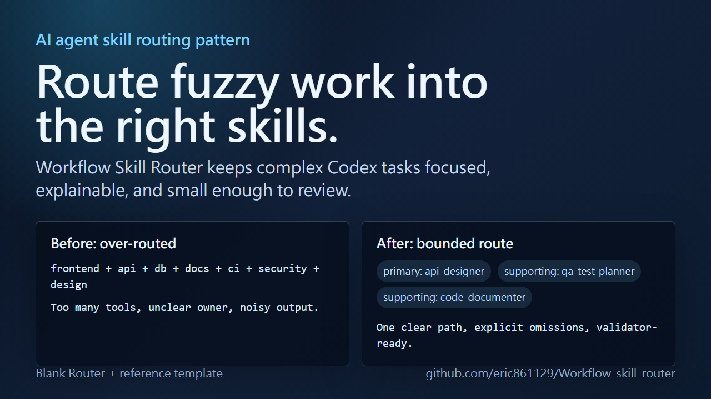
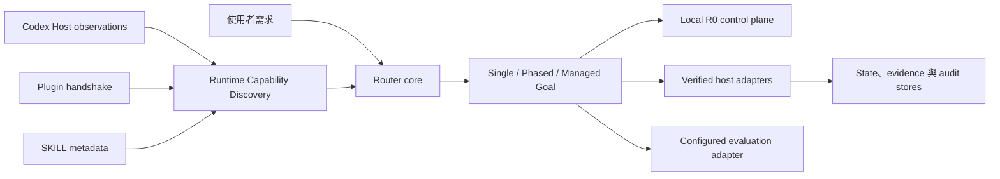

# Workflow Skill Router

**讓 Claude Code 與 Codex 按照你的工作流程做事。**

每個階段一個主導 Skill，只帶這個階段需要的支援，工作流程存成設定檔重複使用。

[](https://github.com/eric861129/Workflow-skill-router/actions/workflows/validate.yml)
[](https://github.com/eric861129/Workflow-skill-router/releases)
[](LICENSE)

[English](README.md) · [繁體中文文件](https://huangchiyu.com/Workflow-skill-router/zh-tw/) · [安裝](#安裝) · [路由範例](#路由範例) · [實測結果與限制](#實測結果與限制)

[](https://huangchiyu.com/Workflow-skill-router/zh-tw/showcase/)

Workflow Skill Router 是給 Claude Code 與 Codex 使用的開源 Plugin，會在 AI agent 開始工作前為目前任務選擇 Skills：選出主導目前階段的 Skill，只加入這個階段需要的支援，並把計畫攤開給你看。工作流程只要定義一次，之後每個任務都會套用。

## 你會得到什麼

- **每個階段都有聚焦的路由。** 規劃 API 變更時，不會提早帶入實作與部署的 Skills。
- **你的選擇優先。** 你指定的 Skill 就是主導者；要加入指定範圍外的支援，會先取得你的同意。
- **工作流程就是設定檔。** 個人或 workspace 的 Skill Tree 把任務對應到 Skills 與完成條件，同一份 Profile 在 Claude Code 與 Codex 都能用。
- **清楚知道實際用了什麼。** 計畫中的 Skill 不會被當成環境裡可用的 Skill。工作結束時，計畫與實際使用的 Skills 會並列回報。

## 安裝

兩種 Plugin 都需要 **Node.js 24+ 與 Python 3.11+**。Plugin 已包含編譯好的 MCP bundle 與 Python runtime，不需要 npm。

### Claude Code

Claude Code 支援目前在開發中主分支，不包含在已發布的 `v2.0.2`。

```text
/plugin marketplace add eric861129/Workflow-skill-router
/plugin install workflow-skill-router@workflow-skill-router
```

Claude Code 會先讀 `.claude/workflow-skill-router.json`，沒有時才讀 `.codex/workflow-skill-router.json`。個人 Profile 與本機狀態和 Codex Plugin 共用。詳見 [Claude Code 安裝指南](site/src/content/docs/zh-tw/guides/install-claude-code.md)。

### Codex Plugin + MCP

已發布版本為 **v2.0.2**。一般的 Codex 安裝請固定使用這個版本。除了路由指引，它也會在本機保存計畫與同意紀錄。

```sh
codex plugin marketplace add eric861129/Workflow-skill-router --ref v2.0.2
codex plugin add workflow-skill-router@workflow-skill-router
codex plugin list
```

開發中主分支另有尚未發布的內容，例如需自行啟用的 Adaptive Workflow Memory。[Plugin 安裝指南](site/src/content/docs/zh-tw/guides/install-plugin.md)說明如何確認安裝結果。

### 獨立 Skill

只需要路由指引、不使用本機 MCP 執行程式時，可以選擇這個模式。下載 [v2.0.2 Skill 套件](https://github.com/eric861129/Workflow-skill-router/releases/download/v2.0.2/workflow-skill-router-skill-v2.0.2.zip)，將內層 `workflow-skill-router/` 資料夾解壓縮到 Codex Skills 目錄。

[Skill-only 安裝指南](site/src/content/docs/zh-tw/guides/install-skill.md) 提供路徑與設定說明。這個模式引導模型行為，無法保存或強制執行 Plugin 的同意狀態機。任何安裝方式都不會附帶工作流程可能引用的所有專業 Skills。

### 確認可以使用

開啟新的 Claude Code 對話或新的 Codex 任務，輸入：**「顯示 Workflow Skill Router 的狀態，並說明目前環境可以使用哪些能力。」** 回應應顯示 `bundled-local-r0` runtime，並列出目前環境可用的能力。

## 路由範例

內附的 [workspace Profile 範例](starter/v2/workflow-skill-router/assets/workspace-routing-profile.example.json)定義了一套 API 交付流程。套用這份 Profile 後，像 *「Deliver the api contract, implementation, and tests」* 這樣屬於 `api` domain 的請求，會產生如下的分階段計畫：

| 階段 | 主導 Skill | 該階段的支援 | 完成條件 |
| --- | --- | --- | --- |
| contract | `api-designer` | `api-guidelines-skill` | `contract-reviewed` |
| implementation | `csharp-developer` | 無 | `implementation-complete` |
| verification | `qa-test-planner` | `playwright` | `tests-passed` |

只有目前階段的 Skills 會成為生效中的路由，下一個階段開始時會重新路由。每個計畫中的 Skill 都維持 `intended-unverified`，直到執行環境確認它已安裝且可用。這是在說明可設定的行為，並非已量測的開發成果。

## 適合哪些情境

| 你的情況 | Router 提供的幫助 |
| --- | --- |
| Skills 職責重疊，經常需要重複交代由誰主導 | 可重用的個人或工作區路由設定 |
| 工作需要經過規劃、實作與驗證 | 每個階段分別選擇 Skills，並設定完成條件 |
| 跨專案工作有相依關係，需要保留進度後續作 | 本機工作圖與明確的下一步；整合原生 Goal 仍需要執行環境支援 |
| 只有一件小任務，也已知道該用哪個 Skill | 維持小範圍路由；額外設定可能沒有太多幫助 |

## 如何運作

1. **讀取任務與你的明確指定。** 判斷是單一任務、多階段流程，還是需要管理相依關係的工作圖。
2. **套用你的工作流程。** Personal Routing Profiles 將任務對應到主要 Skill，以及目前階段需要的支援。
3. **確認能力是否可用。** Runtime Capability Discovery 區分預計選用的能力，以及目前環境確實能使用的能力。
4. **讓計畫可以被檢查。** 在 AI agent 繼續前，顯示路由、缺少的能力，以及需要確認的支援項目。

本機執行程式以固定規則分類工作、比對路由設定。它不會安裝或啟用 Skills、選擇底層模型，也不會授予部署權限。Skill 是針對特定工作整理的可重用指令；Router 協調何時使用哪些 Skills，實際工作仍由 AI agent 與選定的 Skills 執行。[閱讀架構總覽](docs/architecture/v2-overview.md)。

開放原始碼讓使用者可以檢查路由規則、調整個人或團隊流程，並驗證它對自己的任務是否有幫助。

## 實測結果與限制

2026-10-19 的探索性測試使用六個案例，比較模型自行路由與加入 Router 後的決策。測試模型包含 GPT-6.1 Sol、GPT-6 Astra、GPT-6 Luna，推理設定固定為 `medium`，每組每個案例只執行一次。測量範圍是路由決策，沒有執行完整軟體開發。

第一輪發現案例前提有歧義。釐清前提並更新指引後，僅對 Sol 重新進行成對測試：最終路由欄位全部符合的案例，從基準組 3/6 到 Router 組 6/6；較嚴格的完整契約則分別為 0/6 與 3/6。新分數不能直接與舊契約的分數相比，Astra 與 Luna 尚未使用更新後的內容重測。其中一個評分標籤仍取決於如何解讀使用者的間接指定；在該案例中，兩組其實選擇了相同的必要能力。

目前觀測到的價值在於**工作流程的一致性**，但需要保留這些限制：

- 部分簡單案例中，模型原本就能選對 Skills。Router 是否有額外價值，取決於你需要遵循哪些流程規則。
- 測試完整載入指令套件，輸入 Token 增加約 26–28%；尚未證明能降低成本、加快交付或提升程式品質。
- 單次執行無法證明穩定性，也不代表正式模型資格通過。這次比較沒有驗證完整 Plugin／執行環境整合或真實開發成果。
- 這次比較只使用上述模型；Claude Code 支援尚未以 Claude 模型評測。

詳細範圍與結果見[評測方法及實測紀錄](evaluation/v2/README.md)。評測方法以英文撰寫，這次的詳細結果以繁體中文記錄。結果仍屬探索性、待審查，不能作為已發布 v2.0.2 的資格證明，也不能用來替模型排名。

## 延伸閱讀

- [Claude Code 安裝指南](site/src/content/docs/zh-tw/guides/install-claude-code.md)：安裝、驗證，並與 Codex 共用 Profile。
- [Personal Routing Profiles](site/src/content/docs/zh-tw/concepts/personal-routing-profiles.md)：定義自己的流程，並檢查規則為什麼命中。
- [執行環境的可用能力](site/src/content/docs/zh-tw/concepts/runtime-capability-discovery.md)：理解已安裝、可使用與已授權的差異。
- [安全邊界](site/src/content/docs/zh-tw/reference/security-boundaries.md)：了解哪些決定仍由使用者與執行環境掌握。
- [參與貢獻](CONTRIBUTING.md)：改善專案，或回報可重現的路由問題。請附上版本、安裝模式、預期路由及已去識別的結果。

<details>
<summary>貢獻者與整合者的技術參考</summary>

以下說明開發中原始碼與相關契約，發布版本及需要執行環境支援的行為會另外標示。

獨立 Skill 使用 `skill-only-fallback` 標籤，不能宣稱符合 `hybrid-full`。

## 架構：先做 Runtime Capability Discovery

Runtime Capability Discovery 把常被混為一談的五個事實分開：已安裝 metadata、Host exposure、驗證狀態、policy eligibility 與 freshness。只有通過對應風險條件的能力才能進入路由。



Maintainer 可先閱讀 [V2 架構總覽](docs/architecture/v2-overview.md)。

## Single、Phased 與 Managed Goal

- **Single**：處理一個有明確邊界的意圖，只選最小 Primary capability。
- **Phased**：保留不同階段，並依當下證據為每個 Phase 重新路由。
- **Managed Goal**：維護可恢復的 Work Graph、尊重依賴關係，並把 Codex Goal 視為 Host-owned state。

Router 不會把每個任務都塞進 Goal 流程。工作形狀由需求、依賴、風險與目前 Goal relation 共同決定。

`plan_work` 會結合工作包絡的 **deterministic automatic classification**，以及使用者 Skill Tree 的 **optional deterministic Profile**。Classifier 是有界的結構與詞彙規則，不是 semantic model；回應會把分類來源、信心、revision、reason codes 與 Profile match source 分開呈現。Planned Skills 只代表規劃意圖，actual activation 仍是 `unverified`。Explicit Skill Lock 與 consent 邊界持續有效；本機 Router 不會啟用 Skills、不會修改 native Codex Goal，也不會授予 deployment/production authority。

## Explicit Skill Lock

使用者指定 SKILL 時，該選擇具有權威性。Router 可以建議支援能力，但啟用前必須說明用途、scope、拒絕後果與 context cost。被拒絕的支援不得進入 active selections。

Plugin 模式會在詢問前先持久化 proposal。後續 model turn 只分類 `approved`、`rejected` 或 `unclear`；deterministic MCP transition 會保留 bound route，Phase、scope、revision 或 material context 改變時則 fail closed。Skill-only 仍保留相同互動政策，但只能宣稱 advisory instructions，不能宣稱 durable enforcement。

使用者未指定 SKILL 時，Router 直接選擇最小充分路由，不會為自己推薦的支援能力反覆詢問。執行前宣告預計使用的 SKILL，完成後回報實際使用項目與差異。

## Personal Routing Profiles / 個人 Skill Tree

V2 保留了 V1 最重要的精髓：使用者仍能擁有自己的 Skill Tree。Personal Routing Profile 可依 objective keywords、domains、tags 與 work modes，定義每個 Phase 的單一 Primary、最多三個目前 Phase support SKILL，以及 exit gate。

> Personal Routing Profiles 隨 `v2.0.0-beta.2` 提供。beta.1 的 36-attempt Model Evaluation 是歷史 runtime evidence，不涵蓋這項 Profile 功能。

優先序固定為：Host hard constraints、使用者當次明確指定 SKILL、workspace profile、personal profile、built-in routing。Workspace Profile 放在 `.codex/workflow-skill-router.json`；Personal Profile 放在 Router 的外部資料目錄。MCP 只接受 Client 公告 root 或 `WORKFLOW_SKILL_ROUTER_WORKSPACE_ROOTS` 內的 workspace 讀取；模型任意提供的本機路徑會 fail closed。Workspace 命中後採用整棵 tree，不與 personal tree 做隱含 deep merge。

```powershell
Copy-Item starter/v2/workflow-skill-router/assets/personal-routing-profile.example.json ./my-profile.json
python plugins/workflow-skill-router/runtime/workflow_skill_router.pyz profile validate .\my-profile.json
python plugins/workflow-skill-router/runtime/workflow_skill_router.pyz profile install .\my-profile.json
python plugins/workflow-skill-router/runtime/workflow_skill_router.pyz profile list
python plugins/workflow-skill-router/runtime/workflow_skill_router.pyz profile preview --objective "交付 API" --work-mode phased --domain api
python plugins/workflow-skill-router/runtime/workflow_skill_router.pyz profile preview --objective "交付 API" --work-mode phased --domain api --explain
python plugins/workflow-skill-router/runtime/workflow_skill_router.pyz profile lint .\my-profile.json
```

Generated Plugin runtime 支援 `profile preview --explain` 與 `profile lint`；兩者都只是 deterministic diagnostics，不會公開 SKILL instruction body，也不會授予 authority。Plugin + MCP 會 deterministic 載入與驗證 Profile。Skill-only 只有在 Host 授權讀取固定 Profile 位置時，才能依相同契約做 `skill-only-fallback` advisory routing；否則必須由使用者在對話中提供 Profile 內容。Skill-only 不能宣稱 durable loading 或 enforcement。兩種模式下，Profile 結果都只是 `intended-unverified`；Runtime Capability Discovery 仍決定 SKILL 是否 installed、exposed、compatible、authorized 與 eligible。Profile 不會安裝 SKILL，也不會授予權限。完整說明請看 [Personal Routing Profiles](site/src/content/docs/zh-tw/concepts/personal-routing-profiles.md)。

## MCP tool surface

已發布 `v2.0.2` 提供以下十二個 typed tools；開發中主分支另有八個 Memory tools，合計 20 個：

```text
sync_runtime_context       plan_work                  propose_support_consent
transition_support_consent get_next_work              validate_route
record_work_event          evaluate_gate              get_router_status
run_model_evaluation       compare_evaluations        export_router_artifact
```

Tool schema、risk、required capabilities 與 fallback actions 都從 Server 使用的相同 contract 產生。請看 [generated MCP reference](site/src/content/docs/zh-tw/reference/mcp-tools.mdx)。

## Runtime readiness matrix

### 已發布版本（`published-v2.0.2`）

`v2.0.2` 有 12 個工具：**4 always local-ready + 3 Router-owned conditional-local**、2 個 verified-Host-required，以及 3 個 configured-adapter-required。發布版已包含本機工作迴圈，但不包含後續的 Adaptive Workflow Memory。

### 開發中主分支（`development-main`）

主分支增加 8 個 Memory 工具，合計 20 個；Memory 預設關閉。下表描述目前原始碼，不能用它推定已安裝發布版的能力。

| Availability | Tools | 條件 |
| --- | --- | --- |
| `local-ready` (10) | `plan_work`, `propose_support_consent`, `transition_support_consent`, `get_router_status`, `get_memory_status`, `remember_workflow`, `record_route_feedback`, `list_workflow_candidates`, `preview_profile_update`, `purge_workflow_memory` | 本機工具仍須通過個別輸入、Policy 與確認條件；local-ready 不等於所有副作用都已獲准。 |
| `conditional-local` (5) | `get_next_work`, `record_work_event`, `evaluate_gate`, `transition_profile_update`, `rollback_profile_revision` | 依工具檢查 Router 自有工作圖或受 Policy 約束的本機 Profile；本機工作迴圈回傳 `authority_mode=router-local`。`get_next_work` 回傳 `host_goal_mutated=false`；事件與閘門呼叫則回傳 `host_transition_authorized=false`。 |
| `verified-host-required` (2) | `sync_runtime_context`, `validate_route` | 必須具備已驗證的 Host 權威。 |
| `configured-adapter-required` (3) | `run_model_evaluation`, `compare_evaluations`, `export_router_artifact` | 必須具備已設定的評估介面與授權。 |

發布版與主分支都保留 Explicit Skill Lock 與 consent。Native Goal 仍由 Host 管理；local gate 通過不代表 Skill 啟用、部署或正式環境授權。

| Runtime 情況 | `get_next_work` | `record_work_event` | `evaluate_gate` |
| --- | --- | --- | --- |
| 有效 Router-owned graph | Router-local 結果 | Router-local 回報式進度 | Router-local advisory gate |
| Native Goal | `verified-host-scheduler` | `verified-event-store` + `activation-receipt-verifier` | `verified-evidence-store` + `gate-authority` |
| 缺少 Router-owned graph | `router-owned-work-graph`；在本機建立或 replay | `router-owned-work-graph`；在本機建立或 replay | `router-owned-work-graph`；在本機建立或 replay |
| Router-owned graph 損毀 | 已清理的 `internal-error` | 已清理的 `internal-error` | 已清理的 `internal-error` |

缺少 graph 是本機 graph 初始化條件，不應捏造 Host fallback。Graph 損毀代表完整性邊界失敗，公開回應只透過 `internal-error` 提供 correlation，內部細節只留在 diagnostics。Native Goal 則依上表使用各工具自己的 verified Host capability。

不可用的呼叫會回傳 typed `capability-unavailable`、required capabilities 與 fallback action。Router 不會捏造 scheduler 或 evaluation 成功結果；V1.3.1 可透過不可變 tag 取得；`latest` 等頻道以經審查的 release metadata 為準。

<!-- M4-B adaptive-memory:start -->
## Adaptive Workflow Memory

Adaptive Workflow Memory 是選擇加入、本機優先的路由記憶層，會把重複成功的路由整理成可審查的 Managed Profile。它維持 `default-off`：升級後不會自動 capture、不建立 Optional Memory DB，也不修改 User-owned Profile。

建議採 `observe -> reviewed -> automatic`。Personal Policy 是自主上限，Workspace 只能收緊。Automatic promotion 僅寫入 `automatic-managed` target，必須顯示通知，且仍是明確觸發的本機 pass，維持 `no background learning` 與 no telemetry。

完整說明位於 `site/src/content/docs/zh-tw/concepts/adaptive-workflow-memory.md` 與設定指南。
<!-- M4-B adaptive-memory:end -->

## Real Model Evaluation

**Tier 0 Contract** fixtures 只證明 deterministic compatibility，不是模型行為。Behavior evidence 需要 fresh isolated attempts、sealed case package、paired baseline/candidate manifests、bounded output、零 hard violation，以及公開前的可信任審查。Baseline arm 明確採 `model-only`，candidate 採 `hybrid-router`；consent follow-up 由 fresh model 分類 intent，再由持久化 MCP state machine 產生最終 route。

Evaluation contract `2.3.1` 保留目前 Phase oracle 與有狀態的 Phase-transition 評分，並把每次 Behavior run 綁定到乾淨、完整的 source revision 與已驗證的 adapter entrypoint identity。Runner 會在每次 adapter invocation 前後重新驗證來源與 adapter，因此 source 改變、adapter 被複製、改名或替換時，都不能繼續既有 run。六案例 beta profile 維持 36 attempts／42 model turns；十三案例 full gate 在每個 arm 重複三次時是 78 attempts／96 model turns。歷史 `2.2.0` reports 保留原本的 case 與 instruction digests，不得用較新的契約重算。新的 `2.3.1` Behavior run 在授權執行前維持 `manual-required`，執行後則在可信 attestation 前維持 `review-required`。

開發中的 Contract 2.3.1 已明確區分既有 workflow 與 Native Goal 綁定前提。`--screening` 使用鎖定的 `exploratory-model` 證據類別，不能替代三次重複的正式資格測試。範圍與解讀方式見[評測協定及目前模型結果](evaluation/v2/README.md)。


## Security boundary 與 local state

Plugin 安裝、SKILL 同意、Runtime 權限與 production authorization 是不同決策。Model 不能提供 evaluation executable path、偽造 Host authority、把 fixture 升格成 runtime evidence，或直接修改 native Codex Goal。

Plugin 將 state 存在 cache 外：

| 平台 | 預設路徑 |
| --- | --- |
| Windows | `%LOCALAPPDATA%\Codex\workflow-skill-router` |
| macOS | `~/Library/Application Support/Codex/workflow-skill-router` |
| Linux | `${XDG_STATE_HOME:-~/.local/state}/codex/workflow-skill-router` |

可用 `WORKFLOW_SKILL_ROUTER_DATA_DIR` 指定其他外部目錄。預設不啟用 telemetry。整合 Host-side R2/R3 行動前，先讀 [security boundary](site/src/content/docs/zh-tw/reference/security-boundaries.md)。

## Contributing

先讀 [CONTRIBUTING.md](CONTRIBUTING.md)，再針對修改範圍執行檢查。Release artifacts 由 allowlist 與 deterministic builder 產生，不手動修改 generated outputs。

需要修改 Router、測試本機原始碼時，可在儲存庫根目錄執行 `codex plugin marketplace add .`，再從這個來源安裝 Plugin。這會載入開發中原始碼，與固定版本的安裝不同。完整步驟見[原始碼安裝指南](site/src/content/docs/zh-tw/guides/install-plugin.md)。

[獨立 Skill 原始碼](starter/v2/workflow-skill-router/SKILL.md) 與 Plugin 內的副本同步維護。

發布候選版本起始狀態為 `prepared-local-candidate`。經審查的 metadata-only promotion 必須綁定 `release_source_revision`、記錄維護者驗證，並將 `release_lifecycle` 設為 `reviewed-attested-publishable`，之後才能執行 `CREATE_V2_RELEASE`。[發布流程](site/src/content/docs/zh-tw/contributing/release-process.md) 定義完整的審查與發布步驟。

```powershell
$env:PYTHONPATH = (Resolve-Path "packages/router-core/src").Path
python -m unittest discover -s packages/router-core/tests -v
python -m unittest discover -s tests -v
python scripts/build-v2-demo-data.py --check
$Version = (Get-Content -Raw -Encoding UTF8 release/version.json | ConvertFrom-Json).v2_version
$Output = Join-Path "dist" "release-$Version"
python -I -S -B scripts/build-release-artifacts.py --output-dir $Output --provenance-mode test --check-determinism
```

Release builder 只允許覆寫目前 manifest 內的既有產物。如果 output directory 含有 stale、非預期、symlink 或其他未列入 manifest 的 path，會直接 fail closed；請使用版本專屬目錄，不要混放不同 release generation。

## Version channels

| Channel | 目前用途 | Promotion rule |
| --- | --- | --- |
| `latest` | 穩定相容頻道 | 以經審查的 release channel metadata 確認目標 |
| `latest-v1` | immutable V1 recovery | 固定 V1.3.1 |
| `latest-v2` | 歷史 V2 prerelease 頻道 | 在 qualified GA promotion 前保留已審查的 prerelease 歷史 |

即使 compatibility channel 尚未移動，Repository 的產品方向仍是 V2-first。版本 metadata 位於 [`release/version.json`](release/version.json)。

## V1 migration

使用 [V1 到 V2 遷移指南](site/src/content/docs/zh-tw/guides/migrate-v1-to-v2.md)，從 template-based routing 遷移至 runtime-aware Plugin 或獨立 SKILL。V1 原始碼與套件仍可從 immutable [`v1.3.1` tag](https://github.com/eric861129/Workflow-skill-router/tree/v1.3.1) 與 GitHub Release 復原，但不再放在 V2 primary navigation。

</details>

[MIT License](LICENSE).
